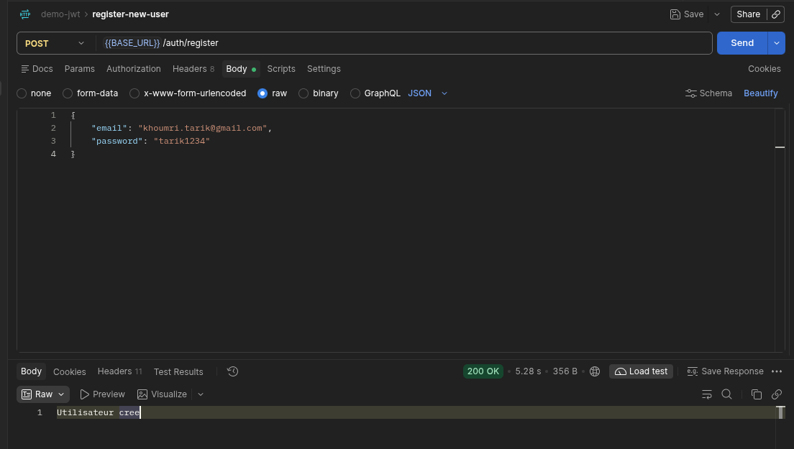
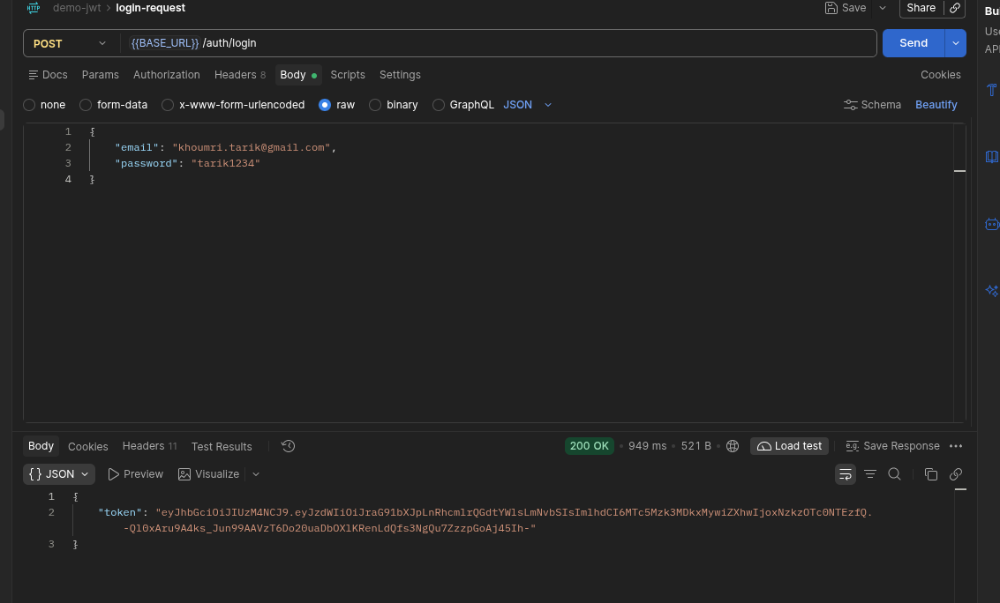
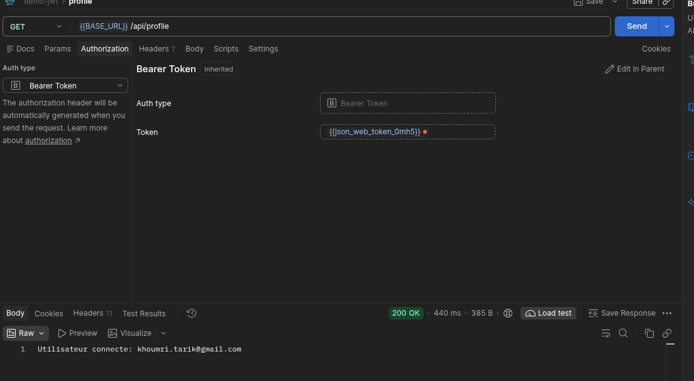
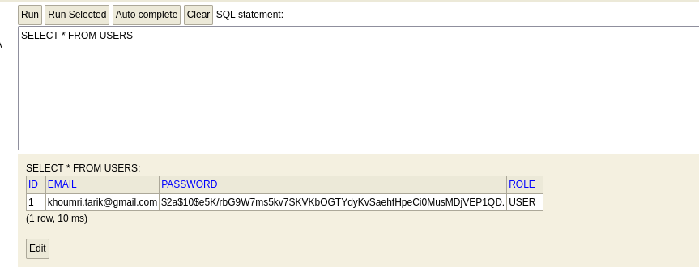

# Backend documentation

This learning project demonstrates user registration and JWT authentication with
Java 21, Spring Boot 4.1.1, Spring Security, Spring Data JPA, and an in-memory H2
database. Passwords are hashed with BCrypt, and authentication is stateless.

## Run the backend

From the repository root:

```sh
cd backend
./mvnw spring-boot:run
```

The base URL is `http://localhost:8080`. In Postman, set `BASE_URL` to this value.
Run the tests from the backend directory with `./mvnw test`.

## 1. Register a user

Send `POST /auth/register` with `Content-Type: application/json` and this body:

```json
{
  "email": "user@example.com",
  "password": "demo-password"
}
```

The backend hashes the password, assigns the `USER` role, and saves the user.
Success returns `200 OK` with `Utilisateur cree`. An email that is already
registered returns `400 Bad Request` with `Email Deja utilises`.

The screenshots use an example test account.



## 2. Log in and obtain a token

Send `POST /auth/login` with the same JSON credentials and content type used for
registration. Successful authentication returns `200 OK` with a JSON response:

```json
{
  "token": "<your-jwt>"
}
```

The token identifies the user by email and expires after one hour with the current
configuration. Copy it for the next request.



## 3. Access protected endpoints

Send `GET /api/profile` with this request header:

```http
Authorization: Bearer <your-jwt>
```

In Postman, select **Authorization > Bearer Token** and paste only the token.
The response is plain text: `Utilisateur connecte: user@example.com`.
Another protected endpoint, `GET /api/hello`, returns `hello user`.



[SecurityConfig](../src/main/java/ma/enset/security/config/SecurityConfig.java)
allows unauthenticated access to `/auth/**` and `/h2-console/**`, while `/api/**`
requires authentication. The
[JWT filter](../src/main/java/ma/enset/security/security/JwtFilter.java) reads the
Bearer token, validates it through
[JwtService](../src/main/java/ma/enset/security/service/JwtService.java), and sets
the authenticated user for the request. Missing or invalid tokens do not
authenticate the request.

## 4. Inspect users in H2

Open <http://localhost:8080/h2-console/>. No API JWT is required to open the
console; use these database connection settings on its login screen:

- **Driver class:** `org.h2.Driver`
- **JDBC URL:** `jdbc:h2:mem:securitydb`
- **User name:** `sa`
- **Password:** leave empty

Run the following query to see registered users:

```sql
SELECT * FROM USERS;
```

The result contains the user's ID, email, BCrypt password hash, and role.



The database lives in memory, so users are lost when the application stops.
Database settings and the JWT lifetime are defined in
[application.properties](../src/main/resources/application.properties).
